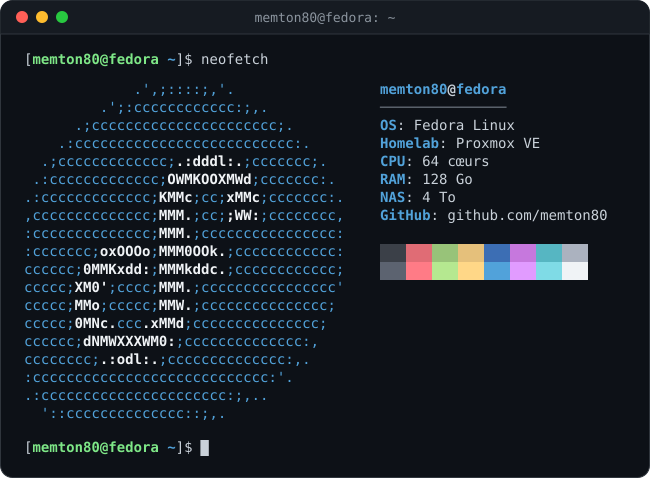

  

  

## 🙋 À propos

- 🐧 J'utilise **Fedora Linux** au quotidien
- 🖥️ Je fais tourner un **homelab sous Proxmox VE** : 64 cœurs et 128 Go de RAM
- 💾 Mes données sont stockées sur un **NAS de 4 To**

<b>🖥️ Mon matériel (cliquer pour déplier)</b>

 

| Machine | Rôle | Caractéristiques |
| :-- | :-- | :-- |
| 🗄️ Serveur Proxmox | Hyperviseur (VM et conteneurs) | 64 cœurs · 128 Go de RAM |
| 💾 NAS | Stockage réseau | 4 To |

## 🛠️ Outils

  
  
  
  
  
  

## 📊 Statistiques GitHub

  
  

  

  

## 🐍 Mes contributions… dévorées

  <picture>
    <source media="(prefers-color-scheme: dark)" srcset="https://raw.githubusercontent.com/memton80/memton80/output/github-snake-dark.svg" />
    <source media="(prefers-color-scheme: light)" srcset="https://raw.githubusercontent.com/memton80/memton80/output/github-snake.svg" />
    
  </picture>

